<a href="https://ludoviccleuet.com">
  <picture>
    <source media="(prefers-color-scheme: dark)" srcset="assets/header-dark.svg" />
    
  </picture>
</a>

&nbsp;

Je suis Ludovic. J'écris du code *que d'autres devront lire*, corriger et faire évoluer sans moi. Je transforme des besoins métier en systèmes lisibles, testés et documentés — et j'embarque les équipes avec.

&nbsp;

<picture>
  <source media="(prefers-color-scheme: dark)" srcset="assets/stack-dark.svg" />
  
</picture>

&nbsp;

  <a href="mailto:ludovic.cleuet@gmail.com">ludovic.cleuet@gmail.com</a>
  &nbsp;·&nbsp;
  <a href="https://ludoviccleuet.com">ludoviccleuet.com ↗</a>
  &nbsp;·&nbsp;
  <a href="https://www.linkedin.com/in/ludovic-cleuet">LinkedIn ↗</a>

